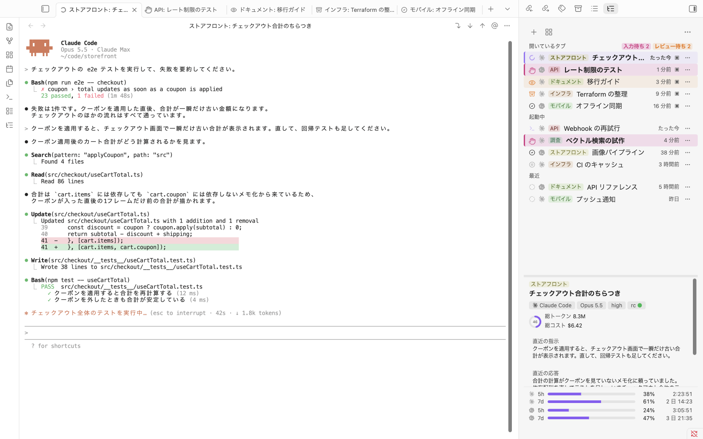
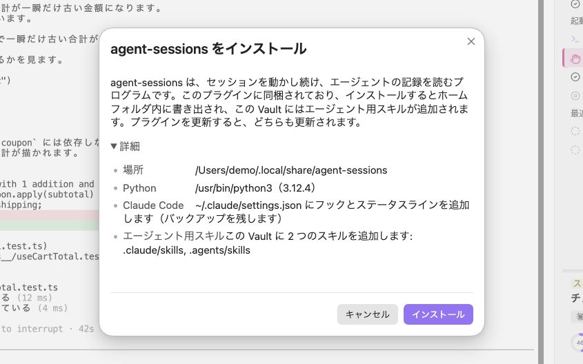
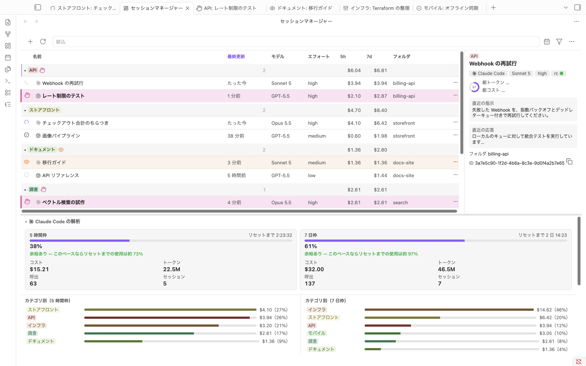
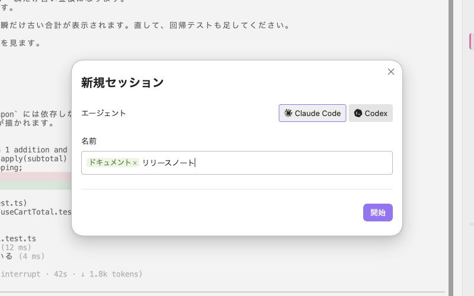
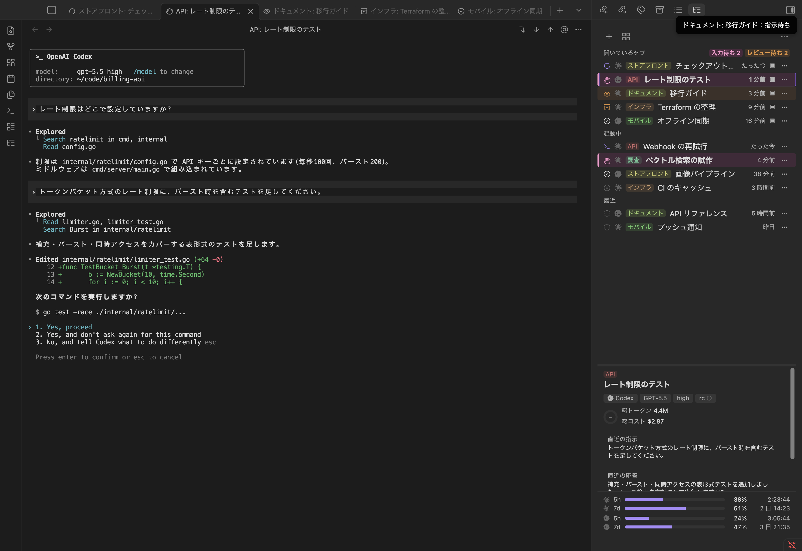
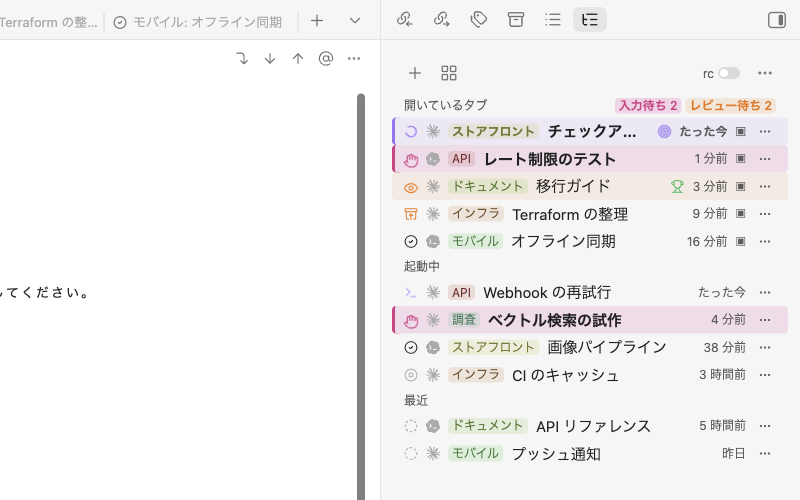

**[English](README.md) | 日本語**

# Agent Sessions

<!-- intro:start (タグライン、導入、「こんな人のために」は 1 つのまとまりです) -->
**仕事を本物のエージェントに預けて、閉じて、戻る。**

[インストール](#インストール) · [ドキュメント](docs/usage.md) · [English](README.md)

[Claude Code](https://claude.com/claude-code)、[Codex](https://github.com/openai/codex)、[OpenCode](https://opencode.ai) を、[Obsidian](https://obsidian.md) のノートの隣のターミナルタブで動かします。実行中・入力待ち・完了のどれかと、使用量・コストが 1 つの一覧に並び、タブを閉じても Obsidian を終了しても、セッションは動き続けます。どのセッションにも記録が残るので、明日はその続きから頼めます。
そのために常駐のヘルパープログラムと、エージェントの設定に追加する hooks を使います。どちらも下に一覧があり、ボタン 1 つで削除できます。

- **タブを閉じても、Obsidian を終了しても、セッションは動き続けます。** 小さな Python のヘルパーが常駐します。削除は設定から。（[起動するプログラム](#起動するプログラム)）
- **どのセッションにも記録が残ります。** 終了したセッションは会話の続きから再開でき、タブごとに別のセッションです。（[サイドパネルでのセッションの切り替え](#サイドパネルでのセッションの切り替え)）
- **全セッションの状態・使用量・コストが 1 つの一覧に。** 読むのはこのマシン上のエージェントのローカルファイルです。（[ネットワーク](#ネットワーク)）

## こんな人のために

Claude Code・Codex・OpenCode を使っている、または入れる気のある人へ。ノートの隣から仕事を預けたい人。

- Claude Code や Codex を一日中使い、設計書・提案書・ノートを書かせている。
- 複数の案件を並行して回し、どのセッションが自分を待っているかを知りたい。
- 書類を Obsidian に置いていて、そのエディターをターミナルの隣に置きたい。

向かないのは、チャット欄で会話したい人やノートをその場で書き換えてほしい人（使うのはエージェント自身のターミナルです）、モバイルだけで使いたい人、エージェントを WSL で動かす Windows の人です。
<!-- intro:end -->

## インストールで起きること

上のダイアログは、何かをインストールする前にプラグインが出す画面です。

- テレメトリーもアカウントもありません。Remote Control サーバーとようこそガイドの図の読み込み（どちらも[ネットワーク](#ネットワーク)に書いています）を除いて、プラグインはネットワークに接続しません。
- Remote Control は、オンにするまでオフです。
- `~/.claude/settings.json` に hooks を 4 つとステータスラインを書きます。先にバックアップを取ります。（[書き込むファイル](#書き込むファイル)）
- 削除は **設定 → agent-sessions プログラム → 削除** で完了します。（[アンインストール](#アンインストール)）

## 動作に必要なもの

- Obsidian 1.8.7 以降のデスクトップ版（macOS・Linux・Windows）。
- Python 3.9 以降。追加のパッケージは要りません。ヘルパープログラムの実行に使います。
- Claude Code、Codex、OpenCode のいずれか（インストールとログイン済み）。契約済みのものをそのまま使い、このプラグイン用のアカウントやキーは要りません。
- 使ったことがなければ、先に公式のページから入れてから戻ってきてください（[Claude Code](https://claude.com/claude-code)、[Codex](https://github.com/openai/codex)、[OpenCode](https://opencode.ai)）。

## エージェントを選ぶ

契約済みのエージェントをそのまま使います。別のアカウントもキーも要りません。

| エージェント | タブで開く | 状態つきで一覧に出る | 使用量とコスト |
|---|---|---|---|
| Claude Code | ✅ あり | ✅ あり | ✅ あり |
| Codex | ✅ あり | ✅ あり | ✅ あり |
| OpenCode | ✅ あり | ✅ あり | コストのみ |

## Obsidian の中で動かす理由

- プロンプトエディター（Ctrl+G）は Obsidian のペインで、`@` によるファイル補完、通常の貼り付け、元に戻す、IME が使えます。[詳しく](docs/usage.md#built-in-editor)
- エージェントの出力にある vault のパスは、リンクで開けます。
- セッションは普通の Obsidian のタブなので、ノートの隣に分割して置けます。

## 機能

### カテゴリ別のセッションと、利用状況とコスト

**セッションマネージャー** は、`カテゴリ: 名前` の形の名前でセッションをまとめ、5 時間枠と 7 日枠のコストを示します。その下に、エージェントごとの利用枠、リセットまでの時間、今のペースで上限に届くかどうかが出ます。コストは、エージェントが残すファイルをもとに、このマシンの中で計算した推定値です。[詳しく](docs/usage.md#session-manager)

### どのエージェントでもセッションを開始

**新規セッション** で名前を入れます。複数のエージェントを有効にしていれば、どれを使うかも選びます。Claude Code・Codex・OpenCode のセッションは、同じ一覧に並びます。[詳しく](docs/usage.md#start-a-session)

### エージェントの CLI をそのままタブで

各セッションでは、エージェントのコマンドラインプログラムそのものが Obsidian のタブで動きます。設定、ログイン、スラッシュコマンド、フック、スキル、MCP サーバーは、ターミナルと同じように使えます。[詳しく](docs/usage.md#work-in-a-session-tab)

### サイドパネルでのセッションの切り替え

開いているタブ、タブのない起動中のセッション、最近のセッションを、状態のアイコンつきで並べます。クリックすると、そのタブが前に出ます。タブがなければ、新しいタブで開きます。終了したセッションは、会話の続きから再開します。一覧の下の詳細には、選んだセッションの状態と、その意味を一文で示します。[詳しく](docs/usage.md#switch-between-sessions)

### ほかの機能

- **[Remote Control](docs/usage.md#remote-control-server)**　サイドパネルの **rc** スイッチで、claude.ai や Claude アプリからこの vault で Claude Code のセッションを始められます。押すまでオフです。[ネットワーク](#ネットワーク)も見てください。
- **[名前の変更とカテゴリ分け](docs/usage.md#name-and-group-sessions)**　`ドキュメント: リリースノート` のような名前で、セッションがカテゴリに入ります。
- **[エージェントによる名前とカテゴリの提案](docs/usage.md#organize-names-and-categories)**　**選択を適用** を押すまで、何も変わりません。セッションの抜粋をそのエージェントに送ります。[整理で送る内容](#整理で送る内容)を見てください。
- **[圧縮・再起動・モデル変更](docs/usage.md#compact-restart-and-change-model)**　セッションの ⋯ メニューから行えます。
- **[利用枠を増やす](docs/usage.md#stretch-your-usage-limit)**　直近の作業をエージェントが読み、無駄なトークンを 9 つの観点で探して、直し方を示します。統計はこのマシンに残ります。[「利用枠を増やす」で送る内容](#利用枠を増やすで送る内容)を見てください。
- **[セッション解析](docs/usage.md#session-analytics)**　1 つのセッションのコスト・トークン・ターン数と、プロンプトごとのコスト。
- **[稼働カレンダー](docs/usage.md#activity-calendar)**　いつ、どのエージェントが作業していたかを、7 日枠・週・日で。
- **[ようこそガイド](docs/usage.md#welcome-guide)** と 2 つの[エージェントスキル](docs/usage.md#agent-skills)　使用量、ほかのセッション、プラグインの使い方を、エージェントに尋ねられます。

すべての機能は [`docs/usage.md`](docs/usage.md) にあります。

## 対応環境

| Obsidian | エージェント | 対応 |
|---|---|---|
| macOS | macOS | ✅ 対応 |
| Linux | Linux | ✅ 対応 |
| Windows 10（1809 以降）、11 | Windows | ✅ 対応 |
| Windows | WSL | ❌ 非対応 |
| WSL2（WSLg） | 同じ WSL ディストリビューション | ✅ 対応 |

Obsidian とエージェントは、同じ OS で動かしてください。プラグインがエージェントのプロセスを起動し、そのファイルを読むためです。エージェントを WSL で使うなら、Obsidian も WSL の中で（WSLg で）動かし、vault は `/mnt/c` ではなく WSL のファイルシステムに置いてください。

## インストール

1. Obsidian で **設定 → コミュニティプラグイン → 閲覧** を開き、**Agent Sessions** を検索して、インストールし、有効にします。
2. 開いたようこそガイドに沿って進めます。補助プログラム `agent-sessions` を入れ、最初のセッションを始めます。あとで戻るときは、コマンドパレットで **ようこそガイドの続きから** を実行します。

プログラムの置き場所と、ソースからのインストールは [`docs/installation.md`](docs/installation.md) にあります。

## 困ったとき

- **「agent-sessions が見つからない」**：サイドパネルの **agent-sessions をインストール** を押すか、プラグインの設定でプログラムの場所を指定します。
- **「agent-sessions を自分でインストールし（README を参照）」**：リポジトリから入れて（[`docs/installation.md`](docs/installation.md#from-a-clone)）、プラグインの設定でその場所を指定します。
- **エージェントに「見つかりませんでした。」と出る**：プラグインの設定でパスを指定するか、ようこそガイドの **検出し直す** を押します。
- **変えた設定・フック・スキルがセッションに効かない**：セッションの ⋯ メニューで **セッションを再起動** を選びます。
- **Windows で、インストールのダイアログに Python か Claude Code が無いと出る**：**WinGet で Python をインストール** か **WinGet で Claude Code をインストール** を押します（ユーザー単位で、管理者の確認は出ません）。
- **ARM 版 Windows で、OpenCode のタブが `bun:ffi dlopen() is not available in this build (TinyCC is disabled)` で止まる**：OpenCode の ARM64 版（ARM 版 Windows で WinGet が入れるもの）は、ターミナル画面を起動できません。OpenCode の x64 版を入れてください。x64 版は、Windows のエミュレーションで動きます。
- **フックが `node: not found` で失敗する**、そのほかの場合：[`docs/usage.md`](docs/usage.md#more-troubleshooting)。

## アンインストール

1. **設定 → agent-sessions プログラム → 削除** を押します。動いているセッションを終え、プログラム、エージェントの設定に足した項目、vault のスキルを取り除きます。OpenCode の `tui.json` は元の値に戻します。
2. コミュニティプラグインで **Agent Sessions** を無効にして、削除します。
3. 何も残したくない場合は、`~/.agents/sessions/`、`<vault>/.agents/sessions/`、バックアップの `~/.claude/settings.json.bak-*` と `~/.codex/config.toml.bak-*` を削除します。

ソースから入れた場合は [`docs/installation.md`](docs/installation.md#uninstall) を見てください。

## しないこと

- チャット画面も、ノートへのインライン編集もありません。使うのはエージェント自身のターミナルです。
- 会話の中身は、整理の **提案する** と、利用枠を増やすの **解析する** を押したときを除いて、どこにも送りません。
- **選択を適用** を押すまで、何も名前を変えません。
- OpenCode には利用枠がなく、サブエージェントのセッションと `opencode run` のセッションは一覧に出ません。

## 開示事項

テレメトリーはなく、アカウントも要りません。エージェントの権限はターミナルで使うときと同じで、各自のアカウントでそれぞれのサービスに接続します。

### ネットワーク

- Remote Control サーバーとようこそガイドの図（どちらも下に書いています）を除き、プラグインとプログラムは、自分の処理のためにネットワークへ接続しません。プラグインは、同じマシンで動くプログラムの常駐プロセスとやりとりします。Unix ソケット（モード 0600）を使い、Windows では `127.0.0.1` のランダムなポートと秘密のトークンを使います。
- Remote Control は、サイドパネルの **rc** トグルで入れたときだけ、vault のフォルダで `claude remote-control --spawn=same-dir --permission-mode <モード>` を動かします。この Claude Code のプロセスは Anthropic のサーバーにつながったままになり、あなたの Claude アカウントにログインしている人が claude.ai や Claude アプリから接続するたびに、この vault でセッションを始めます。モードは設定の Claude Code の欄で選べます。既定は auto で、Claude は確認せずにツールを使います。Claude Code が auto を受け付けないときは、既定のモードで動きます。初めてトグルを入れるときと、設定を auto に変えたあとの次の起動では、そのモードで何ができるかをダイアログで示し、確かめてから起動します。トグルを押すまでオフで、Obsidian やプラグインを読み込んでも起動しません。
- ようこそガイドを開いているあいだは、図を `raw.githubusercontent.com` から読み込みます。利用者のデータは送りません。GitHub には IP アドレスと、どの図を求めたかが伝わります。設定の **ガイドの図を GitHub から読み込む** で止められます。

### 起動するプログラム

- `agent-sessions` を、このマシンにある Python で動かします。インストールを押したときにプラグインから書き出すもので、ダウンロードはしません。
- `claude remote-control`：**rc** トグルを押したときだけ。
- インストール済みの Claude Code・Codex・OpenCode の CLI。選んだ場合は `ollama launch opencode`。設定画面では、Ollama のモデルを並べるために `ollama list` を実行します。
- ターミナルと同じ `PATH` を得るため、シェルをログインシェルと対話シェル（`.zshrc` や `.bashrc` を読みます）として起動します。
- Windows では `reg.exe`（`PATH` を読むため）、`py.exe`（Python を探すため）。`winget.exe` は、インストールのボタンを押したときだけです。

### vault の外で読むファイル

セッションの一覧と利用状況のために読みます。

- `~/.claude/projects/`、`~/.claude/sessions/`、`~/.claude/settings.json`
- `~/.codex/`（または `$CODEX_HOME`）
- `~/.local/share/opencode/opencode.db`（読み取り専用で開きます）

読み取り専用で開けないデータベースは、一時フォルダに写して読み、そのあと削除します。

「利用枠を増やす」の解析では、同じ Claude Code の transcript、Codex の rollout、OpenCode のデータベースを読みます。Claude Code は各セッションの始まりに `CLAUDE.md`・`.claude/rules/`・auto memory の `MEMORY.md` の大きさとスキルの数を、Codex は読み込んだ `AGENTS.md` を記録しています。OpenCode については、セッションのフォルダから Git の根までの各フォルダの `AGENTS.md`（無ければ `CLAUDE.md`）と、`~/.config/opencode/AGENTS.md` の大きさを読みます。また、`$CODEX_HOME/config.toml` の最上位の `model` と `model_provider`、`$CODEX_HOME/models_cache.json` のモデルの一覧、`~/.config/opencode/opencode.json` の各プロバイダの `baseURL`（ローカルのモデルかどうかを見分けるため）を読みます。セッションが繰り返し読むファイルの持ち主の指示ファイルを決めるため、そのファイルから上のフォルダに `.git`、`CLAUDE.md`、（Codex と OpenCode は）`AGENTS.md` があるかを確かめます。

### 書き込むファイル

| パス | 中身 | いつ |
|---|---|---|
| `~/.agents/sessions/` | ソケット、ログ、状態ファイル、キャッシュ | 常に |
| `~/.local/share/agent-sessions`（Windows：`%LOCALAPPDATA%\agent-sessions`） | プログラム | インストール時 |
| `~/.claude/settings.json` | 4 つのフック、`statusLine` | インストール時 |
| `~/.claude/keybindings.json` | 送信キー、エディタキー | 既定から変えたとき |
| `~/.codex/config.toml` | 変えた送信キーとエディタキー、未設定ならステータスライン | Codex が有効なとき |
| `~/.config/opencode/plugins/agent-sessions.js` | ステータス用プラグイン | OpenCode が有効なとき |
| `~/.config/opencode/agent-sessions-tui.jsx` | ステータスライン | OpenCode が有効なとき |
| `~/.config/opencode/tui.json` | エディタキー、送信キー、ステータスラインの項目 | OpenCode が有効なとき |
| 一時ファイル | 編集中のプロンプト | 内蔵エディタを開いているとき |
| `~/.agents/sessions/efficiency/cache/` | 「利用枠を増やす」の統計（数値と相対パス。会話の文字列は入らない） | 「利用枠を増やす」を開いたとき |
| `~/.agents/sessions/efficiency/last-<タブ>.json`、`prev-<タブ>.json` | タブ（`claude`、`codex-openai`、`opencode-ollama` など）ごとの直近 2 回の解析の結果（伏せた引用を含む） | 解析したあと |
| `~/.agents/sessions/efficiency-run/current/` | 解析の空の作業フォルダ | 解析している間 |
| `<vault>/.agents/sessions/sessions.json` | ここで始めたセッション（フォルダ、エージェント）、アーカイブ、カテゴリの色、折りたたんだグループ | 常に |
| `<vault>/.claude/skills/` | `agent-sessions` と `agent-sessions-help` のスキル | Claude Code が有効なとき |
| `<vault>/.agents/skills/` | 同じスキル | Codex が有効なとき |
| `<vault>/.opencode/skills/` | 同じスキル | OpenCode だけのとき |

- `~/.claude/settings.json` と `~/.codex/config.toml` は、変える前にバックアップします。`tui.json` の元の値は `~/.agents/sessions/opencode-tui-backup.json` に残します。
- プラグインが足した項目は、Codex・OpenCode・スキルのファイルでは付けた印で、Claude Code では項目のコマンドで見分けます。それ以外の項目は変えません。
- vault を同期していれば、`sessions.json` も同期されます。
- プログラムが置かれうるほかのフォルダ：[`docs/installation.md`](docs/installation.md#where-the-program-goes)。

### 整理で送る内容

**セッション名とカテゴリを整理** で **提案する** を押すまで、何も送りません。押すと、プラグインはエージェントを 1 回だけ起動します。使うのは、Claude Code、Codex、OpenCode のうち最初に見つかったものです。どれを使うかはダイアログに出ます。

- Claude Code：`claude -p` を Sonnet（設定で Haiku）で、ツールなし・記録なしで実行します。
- Codex：`codex exec` を読み取り専用のサンドボックスで、ツール（シェル、Web 検索、MCP サーバー）なしで実行します。
- OpenCode：`opencode run` をツールなしで実行し、保存されたセッションは直後に削除します。

最大 30 件のセッション（または選んだ 1 件）について、今の名前、フォルダ、最初のプロンプト、直近に入力した 3 つのプロンプト、最後の返答の短い抜粋を送ります（フォルダ、プロンプト、返答は、下の解析と同じように伏せます）。あわせて、既存のカテゴリ名と、カテゴリごとのセッション数、セッション名の例を最大 3 つ送ります。もう一度提案させるときは、前回の提案とコメントも送ります。送り先はそのエージェントのサービスで、そのアカウントの利用枠に数えられます。

### 「利用枠を増やす」で送る内容

**利用枠を増やす…** を開いただけでは、このマシンの中で統計を計算するだけで、何も送りません。タブで **解析する** を押したときだけ、その会話のエージェント自身を起動します。9 つの観点を 1 回でまとめて判定し、範囲が 1 回に収まらないときは期間で区切って、順に複数回起動します（最大 10 回）。Codex と OpenCode は、会話で最も多く使ったプロバイダの会話だけを解析し、ほかのプロバイダの会話は対象にしません。

- Claude Code：`claude -p` を Sonnet（設定で Opus）で、ツールなし・記録なしで実行します。
- Codex：`codex exec` を読み取り専用のサンドボックスで、ツールなし・rollout を残さずに実行します。モデルは、Codex があなたのアカウントに出しているモデル（`$CODEX_HOME/models_cache.json`）のうち最も新しい世代の、Sol、無ければ Terra、無ければ Luna です。Codex が使えないと答えたら、同じ世代の次の段、1 つ前の世代、`config.toml` のモデルの順に移ります。ローカルのプロバイダ（Ollama、LM Studio）は、範囲の中で最も多く使ったモデルです。
- OpenCode：`opencode run` をツールなしで、そのプロバイダと、範囲の中で最も多く使ったモデルで実行し、終わったら run のセッションを消します。このマシンで動くプロバイダ（Ollama、LM Studio、`baseURL` がこのマシンのもの）は、そのローカルのモデルで解析し、外へは送りません。

会話を別のエージェントや別のプロバイダへ送ることはありません。タブの統計にも、そのプロバイダのセッションだけが入ります。押す前に、**解析する** の下の **詳細** で送り先・およその量・回数を、その中の **送るものを見る** で、すべての回に送る文字列そのものを確かめられます。

送るのは、範囲のすべての作業の要約です。伏せたセッション名とフォルダ、範囲の合計、指示ファイルの大きさとスキルの数、統計が目を付けた箇所、そしてターンごとに、入力したプロンプト（各 600 字まで）、エージェントの返答の冒頭（200 字）、そのターンの数字（トークン、種類ごとのツール呼び出しの数、読んだ・検索した・編集したパス、中断、間、かかった時間、文脈の大きさ、キャッシュの書き直し、モデル）です。ツールの出力とファイルの中身は送りません。パス、URL（中のユーザー名とパスワードも）、メールアドレス、鍵やトークンらしい文字列は伏せます。ホームフォルダとユーザー名も、どの OS の書き方のパスでも、フォルダ名として単独で出てくるときでも置き換えます。1 回の依頼で最大 60,000 字です。収まらないときは期間で区切って最大 10 回に分け、それでも多いときはプロンプトを短くし、さらに古い作業から外します。直したときに減らせる量は、エージェントではなく、プラグインが記録の数字から計算します。解析は空のフォルダ `~/.agents/sessions/efficiency-run/current/` で動きます。このフォルダは解析のたびに作り直し、終わると消します。Claude Code は、このフォルダ用の空のプロジェクトフォルダを `~/.claude/projects/` に 1 つ残します。統計のキャッシュに会話の文字列は入りません。直近 2 回の結果は、伏せた引用とともに、消すまで `~/.agents/sessions/efficiency/` に残ります。送り先はそのエージェントのサービスで、そのアカウントの利用枠に数えられます。

**エージェントに直してもらう** は、vault で新しいセッションを、読んで直せる依頼文とともに始めるだけです。Claude Code は plan モード、Codex は書く前に承認を求める読み取り専用のサンドボックス、OpenCode は `plan` エージェントで始めます。プラグイン自身はファイルを書きません。

### その他のアクセス

- vault のファイル一覧：内蔵エディタで `@` のパスを補完するときだけ読みます。
- クリップボード：セッション ID、解析の表、Remote Control の接続用リンクをコピーするときと、ターミナルタブで Ctrl+Shift+C / Ctrl+Shift+V を押したとき（macOS 以外）だけ使います。

## 開発

ビルド、テスト、リリース、設計：[`docs/development.md`](docs/development.md)。

## ライセンス

MIT です（[`LICENSE`](LICENSE)）。`plugin/main.js` には xterm.js とそのアドオン（これも MIT）を同梱しています。それらの表示は [`THIRD_PARTY_NOTICES.md`](THIRD_PARTY_NOTICES.md) にあります。
