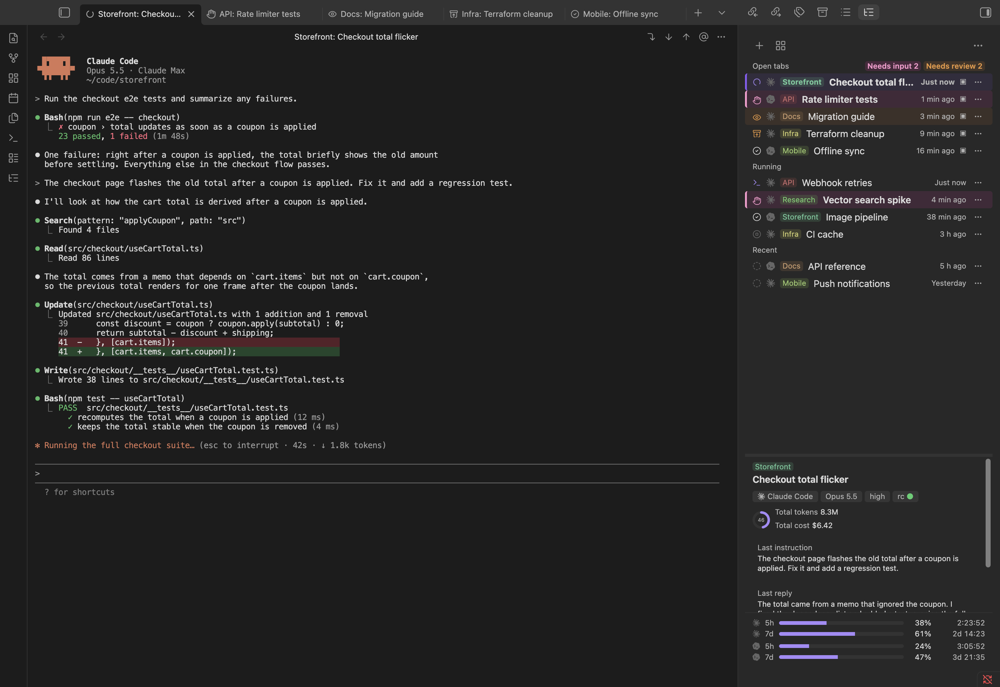
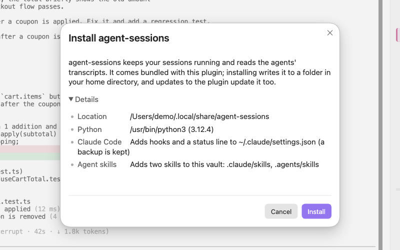
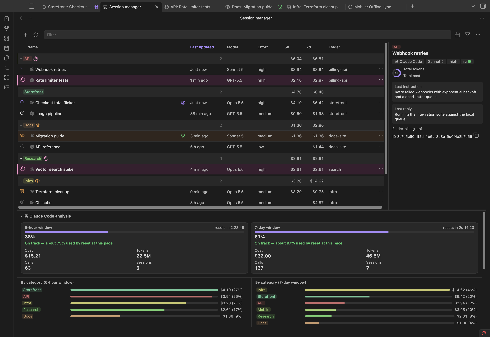
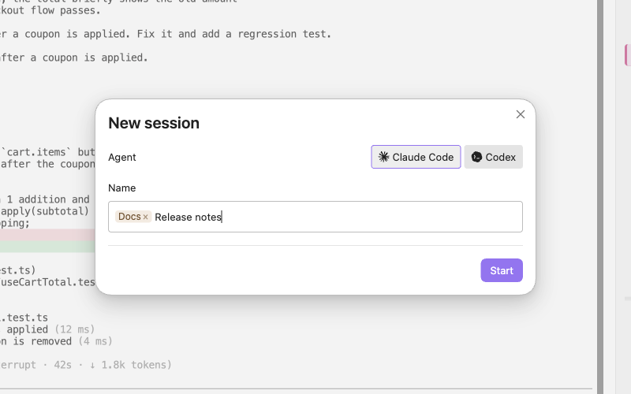
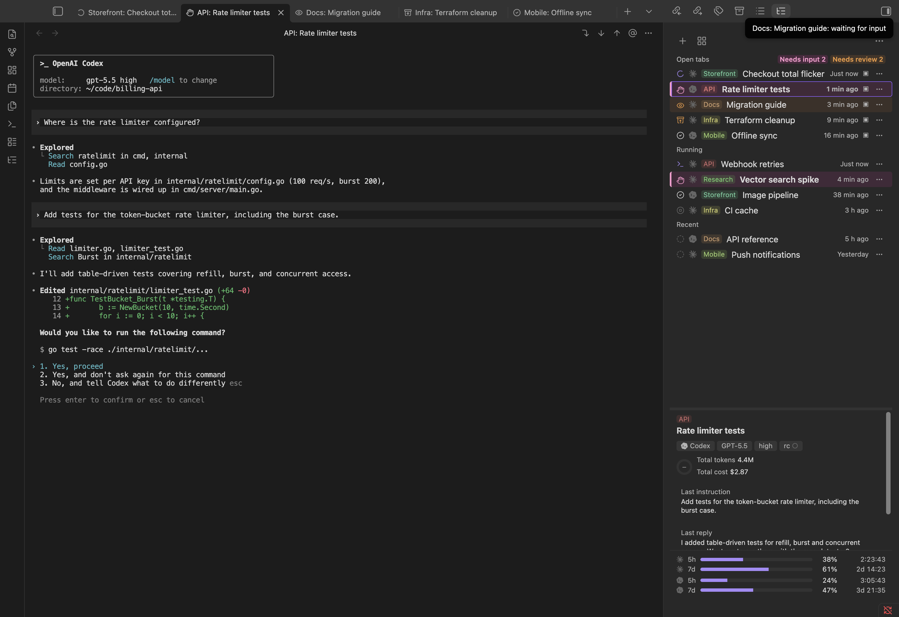
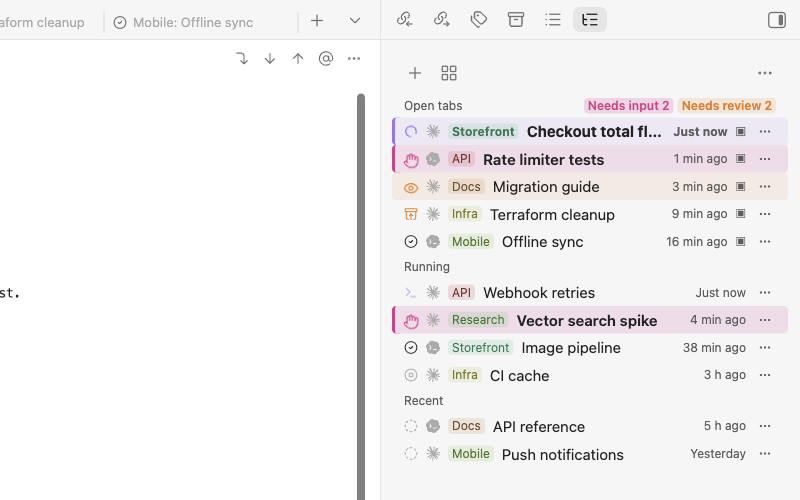

**English | [日本語](README.ja.md)**

# Agent Sessions

<!-- intro:start (tagline, introduction and "Who it is for" are one block) -->
**Hand a job to a real agent. Close the lid, and come back to it.**

[Install](#install) · [Docs](docs/usage.md) · [日本語](README.ja.md)

Run [Claude Code](https://claude.com/claude-code), [Codex](https://github.com/openai/codex) and [OpenCode](https://opencode.ai) in terminal tabs next to your notes in [Obsidian](https://obsidian.md). One list shows which sessions are running, waiting for input or done, with usage and cost, and the sessions keep running when you close a tab or quit Obsidian. Every session keeps its record, so tomorrow you can pick up where you left off.
A helper program and hooks in the agents' settings make this work; both are listed below and removed with one button.

- **Sessions keep running when you close a tab or quit Obsidian.** A small Python helper stays resident; you remove it in Settings. ([Programs it starts](#programs-it-starts))
- **Every session keeps its record.** Reopen an ended session and its conversation resumes; each tab is its own session. ([Switch between sessions](#switch-between-sessions-in-the-side-panel))
- **State, usage and cost of every session in one list.** Read on your machine from the agents' local files. ([Network](#network))

## Who it is for

For people who already run (or are ready to install) Claude Code, Codex or OpenCode, and want to hand work over from next to their notes.

- You use Claude Code or Codex all day, to draft specs, proposals and notes.
- You keep several projects going at once and want to see which session needs you.
- You keep your documents in Obsidian and want its editor next to the terminal.

**Not for:** a chat panel to talk in or inline editing of notes (you get the agent's own terminal), use on mobile only, and Windows with the agents in WSL.
<!-- intro:end -->

## What Install does

The dialog above is what the plugin shows before it installs anything.

- No telemetry and no account. Apart from the Remote Control server and the welcome guide's pictures, both described under [Network](#network), the plugin makes no network connections.
- Remote Control is off until you switch it on.
- Writes four hooks and a status line to `~/.claude/settings.json`, backed up first. ([Files it writes](#files-it-writes))
- Removes cleanly: **Settings → agent-sessions program → Remove**. ([Uninstall](#uninstall))

## Requirements

- Obsidian 1.8.7 or later, on desktop: macOS, Linux or Windows.
- Python 3.9 or later, no extra packages. It runs the helper program.
- Claude Code, Codex or OpenCode, installed and signed in. Your own subscription is used; the plugin needs no account or key.
- Never used one? Install it from its official page first ([Claude Code](https://claude.com/claude-code), [Codex](https://github.com/openai/codex), [OpenCode](https://opencode.ai)), then come back.

## Choose your agent

Use the agent you already pay for. There is no separate account or key.

| Agent | Opens in a tab | Listed with its state | Usage and cost |
|---|---|---|---|
| Claude Code | ✅ Yes | ✅ Yes | ✅ Yes |
| Codex | ✅ Yes | ✅ Yes | ✅ Yes |
| OpenCode | ✅ Yes | ✅ Yes | Cost only |

## Why inside Obsidian

- The prompt editor (Ctrl+G) is an Obsidian pane with `@` file completion, normal paste, undo and IME. [More](docs/usage.md#built-in-editor)
- Vault paths in the agent's output open as links.
- A session is an ordinary Obsidian tab, so it sits in a split beside a note.

## Features

### Sessions by category, with usage and cost

The **Session manager** groups sessions named `Category: Name` and shows their cost per 5-hour and 7-day window. Below, each agent's usage windows show the time to reset and whether you will reach the limit at your current pace. Costs are estimates, calculated on your machine from the agents' local files. [More](docs/usage.md#session-manager)

### Start a session with any agent

**New session** asks for a name, and which agent when more than one is on. Claude Code, Codex and OpenCode sessions share the same lists. [More](docs/usage.md#start-a-session)

### The agent's own CLI in a tab

Each session is the agent's command-line program in an Obsidian tab, with your settings, login, slash commands, hooks, skills and MCP servers. [More](docs/usage.md#work-in-a-session-tab)

### Switch between sessions in the side panel

Open tabs, running sessions without a tab, and recent ones, each with an icon for its state. Click one to bring its tab to the front or open it again; an ended session resumes its conversation. The details below the list name the selected session's state in a sentence. [More](docs/usage.md#switch-between-sessions)

### And more

- **[Remote Control](docs/usage.md#remote-control-server)**: the **rc** switch lets claude.ai and the Claude app start Claude Code sessions in this vault. Off until you click it; see [Network](#network).
- **[Rename and sort into categories](docs/usage.md#name-and-group-sessions)**: a name like `Docs: Release notes` puts a session in the Docs category.
- **[Names and categories suggested by an agent](docs/usage.md#organize-names-and-categories)**: nothing is renamed until you press **Apply selected**. It sends session excerpts to that agent; see [What Organize sends](#what-organize-sends).
- **[Compact, restart or change model](docs/usage.md#compact-restart-and-change-model)** from the session's ⋯ menu.
- **[Stretch your usage limit](docs/usage.md#stretch-your-usage-limit)**: an agent looks through your recent work for wasted tokens in nine areas and says what to change. Statistics stay on this machine; see [What "Stretch your usage limit" sends](#what-stretch-your-usage-limit-sends).
- **[Session analytics](docs/usage.md#session-analytics)**: one session's cost, tokens and turns, with each prompt's own cost.
- **[Activity calendar](docs/usage.md#activity-calendar)**: when each agent was working, by 7-day window, week or day.
- **[Welcome guide](docs/usage.md#welcome-guide)** and two [agent skills](docs/usage.md#agent-skills) that let an agent answer questions about your usage, your other sessions, or the plugin.

All features: [`docs/usage.md`](docs/usage.md).

## Supported environments

| Obsidian runs on | Agent runs on | Supported |
|---|---|---|
| macOS | macOS | ✅ Yes |
| Linux | Linux | ✅ Yes |
| Windows 10 (1809+) or 11 | Windows | ✅ Yes |
| Windows | WSL | ❌ No |
| WSL2 through WSLg | the same WSL distribution | ✅ Yes |

Obsidian and the agent must run in the same operating system, because the plugin starts and follows the agent's processes and files. If your agents run in WSL, run Obsidian in WSL through WSLg, and keep the vault in the WSL file system rather than under `/mnt/c`.

## Install

1. In Obsidian, open **Settings → Community plugins → Browse**, search for **Agent Sessions**, install and enable it.
2. Follow the welcome guide that opens. It installs the `agent-sessions` helper program and starts your first session. To come back to it later, run **Continue the welcome guide** from the command palette.

Where the program goes, and installing from source: [`docs/installation.md`](docs/installation.md).

## Troubleshooting

- **"agent-sessions was not found"**: click **Install agent-sessions** in the side panel, or set the program's location in the plugin's settings.
- **"Install agent-sessions yourself (see the README)"**: install it from a clone ([`docs/installation.md`](docs/installation.md#from-a-clone)), then set its location in the plugin's settings.
- **An agent shows "Not found."**: set its path in the plugin's settings, or click **Detect again** in the welcome guide.
- **A session ignores changed settings, hooks or skills**: choose **Restart session** in the session's ⋯ menu.
- **Windows: the install dialog says Python or Claude Code is missing**: click **Install Python with WinGet** or **Install Claude Code with WinGet** (per user, no administrator prompt).
- **Windows on ARM: an OpenCode tab stops at `bun:ffi dlopen() is not available in this build (TinyCC is disabled)`**: OpenCode's ARM64 build (the one WinGet installs there) cannot start its terminal UI. Install OpenCode's x64 build instead; Windows runs it under emulation.
- **A hook fails with `node: not found`**, and other cases: [`docs/usage.md`](docs/usage.md#more-troubleshooting).

## Uninstall

1. **Settings → agent-sessions program → Remove.** This ends running sessions, removes the program, its entries in the agents' settings, and the skills in the vault, and restores your previous OpenCode `tui.json` values.
2. Disable and remove **Agent Sessions** under Community plugins.
3. If you want nothing left, delete `~/.agents/sessions/`, `<vault>/.agents/sessions/`, and the backups `~/.claude/settings.json.bak-*` and `~/.codex/config.toml.bak-*`.

Source installs: [`docs/installation.md`](docs/installation.md#uninstall).

## What it does not do

- It has no chat panel and no inline editing of notes; you get the agent's own terminal.
- It sends no conversation text anywhere, except when you press **Suggest** in Organize or **Analyze** in Stretch your usage limit.
- It renames nothing until you press **Apply selected**.
- OpenCode has no usage windows, and its sub-agent sessions and `opencode run` sessions are not listed.

## Disclosures

No telemetry and no account. The agents have the same permissions as in your terminal and connect to their own services under your accounts.

### Network

- Apart from the Remote Control server and the welcome guide's pictures, both described below, the plugin and its program make no network connections for their own work. The plugin talks to the program's background process on this machine: a Unix socket (mode 0600), or on Windows `127.0.0.1` on a random port with a secret token.
- Remote Control, when you switch it on with the **rc** toggle in the side panel, runs `claude remote-control --spawn=same-dir --permission-mode <mode>` in the vault folder. That Claude Code process stays connected to Anthropic's servers and starts a session in this vault for each connection made from claude.ai or the Claude app by anyone signed in to your Claude account. The mode is a setting under Claude Code. The default is auto, where Claude uses tools without asking; if Claude Code does not accept auto, the sessions run in its default mode. The first time you turn the toggle on, and the next time after you change the setting to auto, a dialog says what the mode allows, and the server starts only if you confirm. It is off until you click the toggle, and it is never started by loading Obsidian or the plugin.
- While the welcome guide is open, it loads its pictures from `raw.githubusercontent.com`. No data of yours is sent; GitHub sees your IP address and which picture is requested. Turn this off with **Load the guide's pictures from GitHub** in the settings.

### Programs it starts

- `agent-sessions`, with the Python found on your machine. It is written out from the plugin when you click Install; nothing is downloaded.
- `claude remote-control`, only after you click the **rc** toggle.
- The Claude Code, Codex and OpenCode CLIs you installed, or `ollama launch opencode` if you choose it. The settings run `ollama list` to offer your Ollama models.
- Your shell, as a login shell and as an interactive shell (which reads `.zshrc` or `.bashrc`), to get the same `PATH` as a terminal.
- On Windows: `reg.exe` (to read `PATH`), `py.exe` (to find Python), and `winget.exe` only when you click an install button.

### Files it reads outside the vault

To list sessions and calculate usage:

- `~/.claude/projects/`, `~/.claude/sessions/`, `~/.claude/settings.json`
- `~/.codex/` (or `$CODEX_HOME`)
- `~/.local/share/opencode/opencode.db`, opened read-only

A database that cannot be opened read-only is copied to a temporary folder, read, and deleted.

For Stretch your usage limit, it reads the same Claude Code transcripts, Codex rollouts and OpenCode database. Claude Code records the sizes of `CLAUDE.md`, `.claude/rules/` and auto memory `MEMORY.md` and the number of skills at each session's start, and Codex the `AGENTS.md` it loaded; for OpenCode it reads the size of `AGENTS.md` (or `CLAUDE.md`) in the session's folder and the folders above it up to the Git root, and of `~/.config/opencode/AGENTS.md`. It also reads the top-level `model` and `model_provider` of `$CODEX_HOME/config.toml` and the model list in `$CODEX_HOME/models_cache.json`, and the providers' `baseURL` in `~/.config/opencode/opencode.json` (to tell local models). To find the instruction file that owns a file sessions keep reading, it checks whether a `.git`, a `CLAUDE.md` or (Codex and OpenCode) an `AGENTS.md` exists in the folders above that file.

### Files it writes

| Path | Contents | When |
|---|---|---|
| `~/.agents/sessions/` | socket, logs, status files, caches | always |
| `~/.local/share/agent-sessions` (Windows: `%LOCALAPPDATA%\agent-sessions`) | the program | on Install |
| `~/.claude/settings.json` | four hooks, `statusLine` | on Install |
| `~/.claude/keybindings.json` | submit key, editor key | if changed from the default |
| `~/.codex/config.toml` | submit and editor keys if changed, status line if unset | Codex enabled |
| `~/.config/opencode/plugins/agent-sessions.js` | status plugin | OpenCode enabled |
| `~/.config/opencode/agent-sessions-tui.jsx` | status line | OpenCode enabled |
| `~/.config/opencode/tui.json` | editor key, submit keys, status line entry | OpenCode enabled |
| a temporary file | the prompt being edited | built-in editor open |
| `~/.agents/sessions/efficiency/cache/` | statistics for Stretch your usage limit (numbers and relative paths, no conversation text) | Stretch your usage limit opened |
| `~/.agents/sessions/efficiency/last-<tab>.json`, `prev-<tab>.json` | the last two analyses of each tab (`claude`, `codex-openai`, `opencode-ollama`, …), with masked quotes | after Analyze |
| `~/.agents/sessions/efficiency-run/current/` | the analysis's empty working folder | during Analyze |
| `<vault>/.agents/sessions/sessions.json` | sessions started here (folder, agent), archive, category colors, folded groups | always |
| `<vault>/.claude/skills/` | the `agent-sessions` and `agent-sessions-help` skills | Claude Code enabled |
| `<vault>/.agents/skills/` | the same skills | Codex enabled |
| `<vault>/.opencode/skills/` | the same skills | OpenCode alone |

- `~/.claude/settings.json` and `~/.codex/config.toml` are backed up before they are changed. The previous `tui.json` values are kept in `~/.agents/sessions/opencode-tui-backup.json`.
- Its entries are marked (Codex, OpenCode, skill files) or recognized by their command (Claude Code); nothing else is changed.
- `sessions.json` travels with the vault if you sync it.
- Other folders the program may be installed in: [`docs/installation.md`](docs/installation.md#where-the-program-goes).

### What Organize sends

Nothing is sent until you press **Suggest** in **Organize names and categories**. Then the plugin runs one of your agents once, and the dialog names which:

- Claude Code: `claude -p` with Sonnet (or Haiku, in the settings), without tools, nothing saved. Else
- Codex: `codex exec` in a read-only sandbox, without tools (shell, web search, MCP servers). Else
- OpenCode: `opencode run` without tools, its stored session deleted afterwards.

For up to 30 sessions, or the one you chose, it sends the current name, the folder, the first prompt, your last three prompts and a short excerpt of the last reply (the folder, prompts and reply masked as for the analysis, below); your existing category names with their session counts and up to three example session names each; and, if you ask again, the previous suggestion and your comments. This goes to that agent's service under your account and counts toward its usage limits.

### What "Stretch your usage limit" sends

Opening **Stretch your usage limit…** computes statistics on this machine and sends nothing. Only when you press **Analyze** in a tab does the plugin run that conversation's own agent: once, judging all nine areas, or, when the range is too large for one request, once per period, one after another, at most ten times. Codex and OpenCode are analysed for the provider their conversations used most; conversations held with another provider are left out.

- Claude Code: `claude -p` with Sonnet (or Opus, in the settings), without tools, nothing saved.
- Codex: `codex exec` with a read-only sandbox, without tools and no rollout saved, on a model Codex lists for your account (`$CODEX_HOME/models_cache.json`): its newest generation, and in it Sol, else Terra, else Luna; when Codex refuses one, the next tier, then the next older generation, then the model in `config.toml`. A local provider (Ollama, LM Studio) uses its most used model in the range.
- OpenCode: `opencode run` without tools, with the provider and its most used model in the range; the run's session is deleted afterwards. A provider on this machine (Ollama, LM Studio, or a `baseURL` on this machine) is analysed by its local model, so nothing leaves the machine.

A conversation is never sent to another agent or provider, and a tab's statistics name only that provider's sessions. **Details**, below **Analyze**, shows where it goes, about how much and in how many requests before you press it, and **Show what is sent** in it shows the exact text of every request.

What is sent is a digest of every task in the range: the masked session names and folders, the range's totals, the sizes of the instruction files and the number of skills, what the statistics noticed, and for each turn your prompt (up to 600 characters), the start of the agent's reply (200 characters) and its numbers (tokens, tool calls by kind, the paths read, searched or edited, interrupts, pauses, time taken, context size, cache written again, models). Tool output and file contents are not sent. Paths, URLs (with any user name and password in them), e-mail addresses and anything that looks like a key or token are masked, and your home folder and user name are replaced wherever they appear (in a path of any system, or as a folder name of their own). At most 60,000 characters per request; a larger digest is split into requests by period, at most ten, and beyond that the prompts are shortened and then the oldest tasks left out. How many tokens a fix could save is worked out by the plugin from the records, not by the agent. The run starts in an empty folder, `~/.agents/sessions/efficiency-run/current/`, made fresh for each run and removed when it ends; Claude Code keeps one empty project folder for it under `~/.claude/projects/`. The statistics cache holds no conversation text; the last two results, with their masked quotes, stay in `~/.agents/sessions/efficiency/` until you delete them. This goes to that agent's service under your account and counts toward its usage limits.

**Ask the agent to fix it** only starts a new session in the vault, with a request you can read and edit first: Claude Code in plan mode, Codex with a read-only sandbox that asks before writing, OpenCode with its `plan` agent. The plugin writes no file itself.

### Other access

- The vault's file list: only to complete `@` paths in the built-in editor.
- The clipboard: only when you copy a session ID, an analysis table or the Remote Control connection link, or press Ctrl+Shift+C / Ctrl+Shift+V in a terminal tab (not on macOS).

## Development

Build, test, release and design: [`docs/development.md`](docs/development.md).

## License

MIT, see [`LICENSE`](LICENSE). `plugin/main.js` bundles xterm.js and its addons (also MIT); their notices are in [`THIRD_PARTY_NOTICES.md`](THIRD_PARTY_NOTICES.md).
